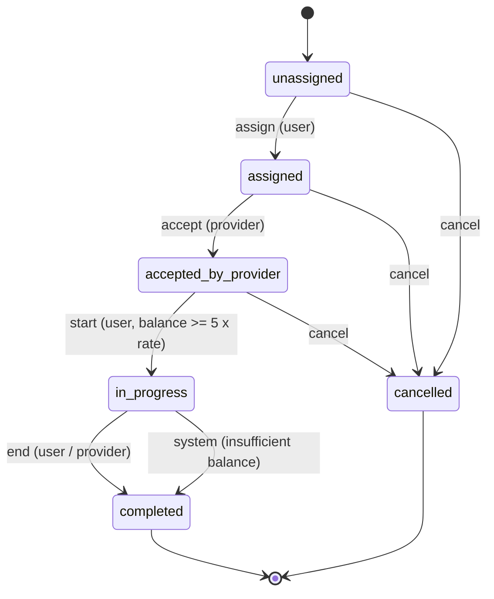
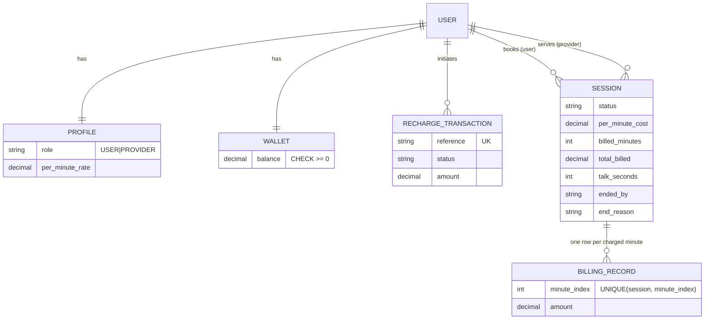

# Wallet-Based Per-Minute Session Billing

Django + Django REST Framework backend for paid 1:1 consultations: prepaid wallet, mock recharge,
session state machine, per-minute billing and automatic termination when the balance runs out.

## Setup

```bash
python -m venv .venv && source .venv/bin/activate
pip install -r requirements.txt
python manage.py migrate
python manage.py createsuperuser   # optional: for the Django admin at /admin/
python manage.py runserver
```

SQLite is used by default. To use PostgreSQL set `POSTGRES_DB` (plus optional `POSTGRES_USER`,
`POSTGRES_PASSWORD`, `POSTGRES_HOST`, `POSTGRES_PORT`) before running `migrate`.

## Run the tests

```bash
python manage.py test
```

22 tests, no `sleep` calls: time is controlled through a fake clock (`core.services.now` is patched).
The six required scenarios are in `core/tests/test_required_scenarios.py`
(`test_1_...` to `test_6_...`); extra cases (DB constraints, roles, frozen rate, cron command) are in `test_extra.py`.

## Project layout

```
core/choices.py     enums: UserRole, RechargeStatus, SessionStatus, EndedBy
core/models.py      Profile, Wallet, RechargeTransaction, Session, BillingRecord
core/services.py    all business rules (state machine, wallet, billing)
core/serializers.py request/response validation
core/views.py       thin API views
core/admin.py       Django admin (read-only for money and session state)
core/errors.py      domain exceptions -> HTTP status codes
core/tests/         required scenarios + extra tests
```

## API (token auth: `Authorization: Token <key>`)

| Method | Endpoint | Who | Purpose |
|---|---|---|---|
| POST | `/api/auth/register/` | public | `{username, password, role: USER\|PROVIDER, per_minute_rate (providers)}` -> token |
| POST | `/api/auth/login/` | public | `{username, password}` -> token |
| GET | `/api/wallet/` | any | current balance |
| POST | `/api/wallet/recharge/` | any | `{amount}` -> pending transaction with `reference` |
| POST | `/api/wallet/recharge/callback/` | mock gateway | `{reference, status: success\|failed}` (idempotent) |
| POST | `/api/sessions/` | USER | create session (`unassigned`) |
| GET | `/api/sessions/`, `/api/sessions/<id>/` | participant | list / detail |
| POST | `/api/sessions/<id>/assign/` | session's user | `{provider_id}` |
| POST | `/api/sessions/<id>/accept/` | assigned provider | accept |
| POST | `/api/sessions/<id>/start/` | session's user | start (needs 5 x rate in wallet) |
| POST | `/api/sessions/<id>/end/` | user or provider | end |
| POST | `/api/sessions/<id>/cancel/` | user or provider | cancel before start |
| POST | `/api/sessions/<id>/bill/` | user or provider | trigger billing (safe to call repeatedly) |

Errors are `{"error": "..."}`: 400 invalid transition / insufficient balance / bad input, 403 wrong role or not a participant.
Periodic billing can also be driven by cron: `python manage.py bill_active_sessions`.

## State diagram



## ER diagram



## Implementation notes (key decisions)

1. **State machine as data.** `TRANSITIONS` in `services.py` maps each action to its allowed source states and target.
   Every action goes through one `_check_transition`, so invalid moves always raise `InvalidTransition` -> HTTP 400 with a clear message.
2. **Prepaid, per started minute.** Minute N is due when minute N begins (`due = floor(elapsed/60) + 1`), so minute 1 is
   charged on start (the 5x minimum balance guarantees it can be paid). Ending mid-minute costs nothing extra because
   that minute is already paid. Example: start, bill at +60s, end at +90s = 2 minutes = Rs 100.
3. **Insufficient balance.** Billing loops over due minutes in order and stops at the first one that can't be paid: the
   wallet is left untouched, status becomes `completed`, `ended_by="system"`, `end_reason="Insufficient Balance"`.
   `talk_seconds` is the *paid* talk time and `ended_at` is where paid time stopped (not when the late billing call happened).
4. **Idempotency, enforced twice.**
   - Recharge: the transaction row is locked (`select_for_update`); the wallet is credited only on the `pending -> success`
     transition. Replays return 200 with `already_processed: true`. A terminal transaction can't change to a different status.
   - Billing: `session.billed_minutes` is the cursor, **and** `BillingRecord` has `UNIQUE(session, minute_index)` so even a race can't charge a minute twice.
5. **Money safety.** `Decimal` everywhere, row locks on session then wallet (consistent order), everything inside `transaction.atomic`,
   plus DB `CHECK (balance >= 0)` as a final guard. Locks are real on PostgreSQL; SQLite serialises writes anyway.
6. **One active session per user** is checked in the service *and* enforced by a partial unique index on `Session(user)` where `status='in_progress'`.
7. **Rate is frozen at start.** Providers have a `per_minute_rate`; it is copied to `session.per_minute_cost` on start and never re-read.
8. **Business logic in `services.py`**, thin views, one exception handler. Time comes from a single `now()` so tests are deterministic.

### Admin
The Django admin (`/admin/`) is included as an optional inspection tool. Wallets, recharges, sessions and billing
records are read-only there on purpose, so money and state can only change through the validated service layer.

### Known simplifications
- Recharge callback is unauthenticated (it is a mock); a real gateway webhook must verify a signature.
- Billing is synchronous and triggered by the `/bill/` endpoint or the management command; production would use Celery/cron.
- Provider payouts/commission are out of scope: only the user's wallet is debited.
